# LLM-Welt – Wie Sprachmodelle denken

**Eine begehbare 3D-Welt, die spielerisch erklärt, wie große Sprachmodelle (LLMs) funktionieren.**
Du gibst einen Satz ein, und ein leuchtender Datenkomet trägt ihn durch alle Stationen eines
Sprachmodells: vom Zerlegen in Tokens über Attention und den Transformer-Turm bis zum Würfeln
des nächsten Wortes. Ein echtes, winziges Modell rechnet dabei live mit.

### ▶ [Jetzt im Browser öffnen](https://msnwaslit.github.io/llm-welt/)

Keine Installation nötig. Läuft in jedem aktuellen Browser mit WebGL (Chrome, Edge, Firefox, Safari).

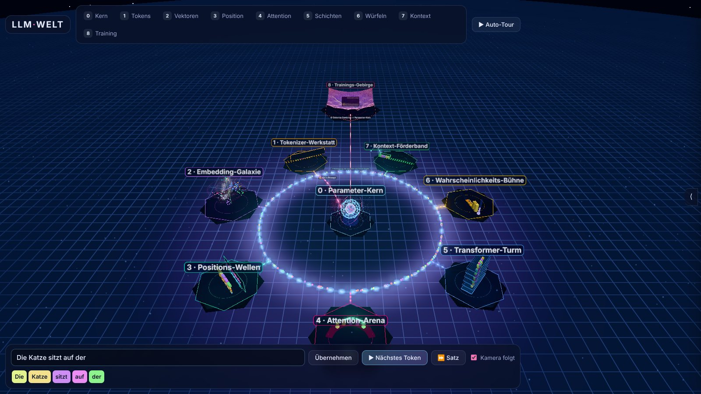

## Die Stationen

| | |
| --- | --- |
| 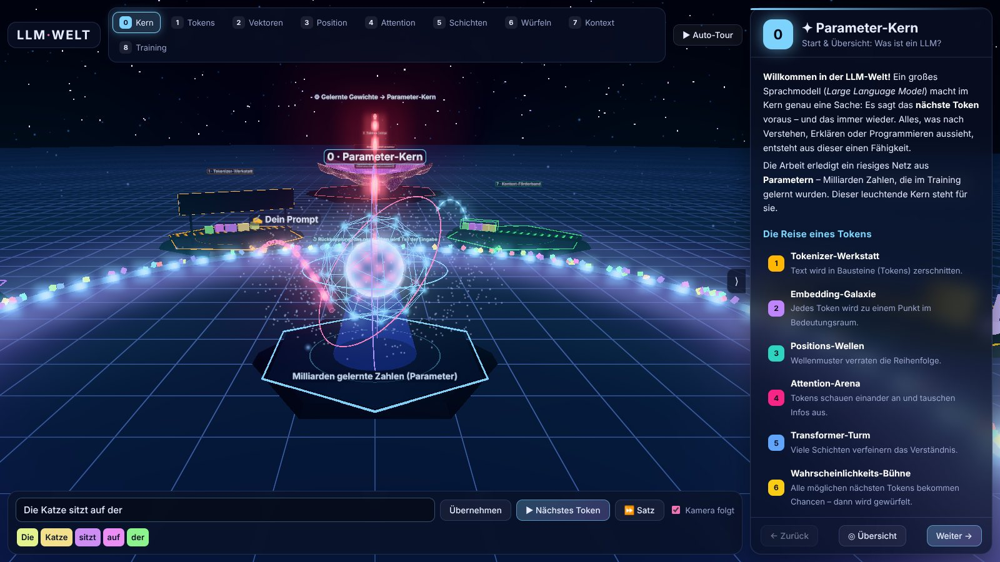 **0 · Parameter-Kern**: Start und Überblick: Was ist ein LLM? | 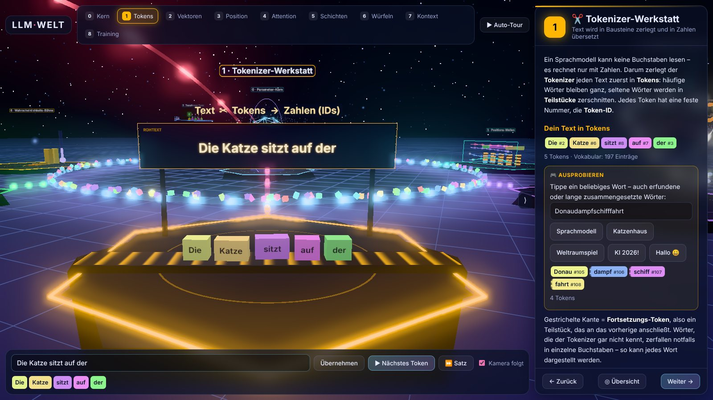 **1 · Tokenizer-Werkstatt**: Ein Laser zerschneidet den Text in Tokens mit Nummern. Eigene Wörter zerfallen im Labor in Teilwörter. |
| 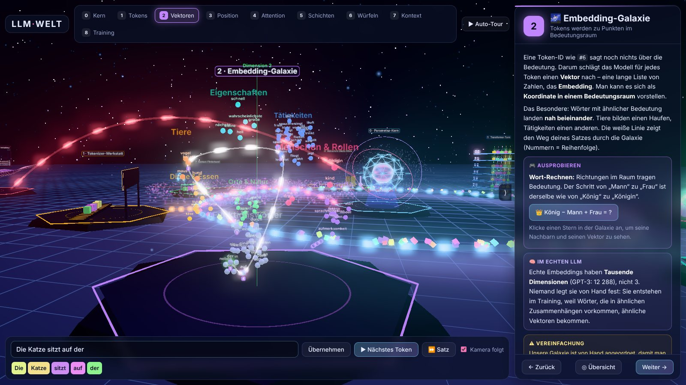 **2 · Embedding-Galaxie**: Wörter als Sterne im Bedeutungsraum, ähnliche Bedeutungen liegen nah beieinander. | 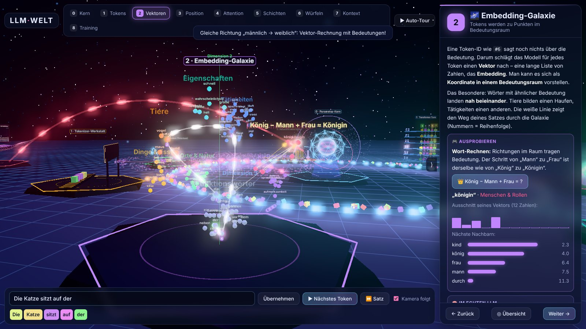 **Wort-Rechnen**: König − Mann + Frau = Königin |
| 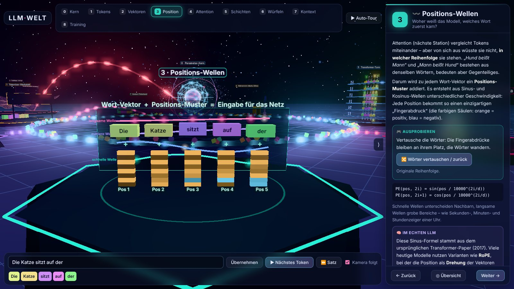 **3 · Positions-Wellen**: Wellenmuster verraten die Reihenfolge. Wörter lassen sich vertauschen. | 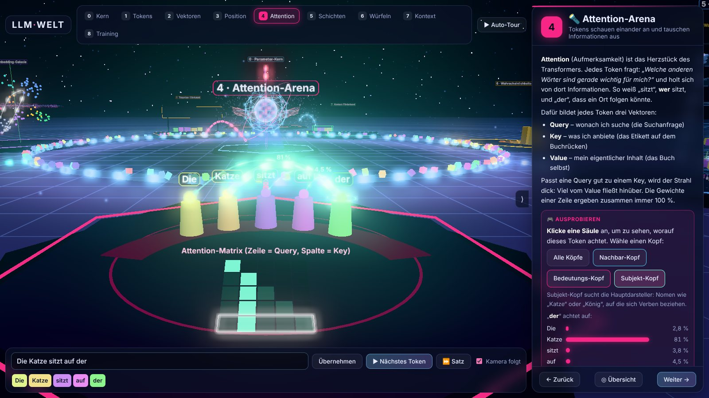 **4 · Attention-Arena**: Strahlen zeigen, worauf jedes Wort achtet. Drei Köpfe, kausale Matrix, Säulen anklickbar. |
| 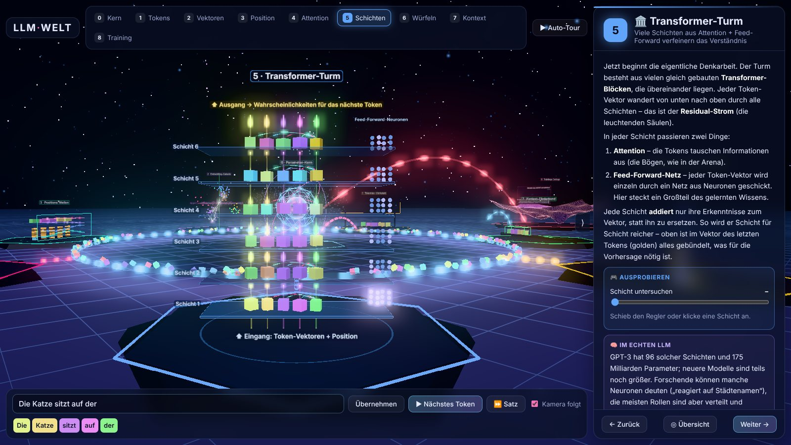 **5 · Transformer-Turm**: Sechs Schichten aus Attention und Feed-Forward, durch die eine Pulswelle läuft. | 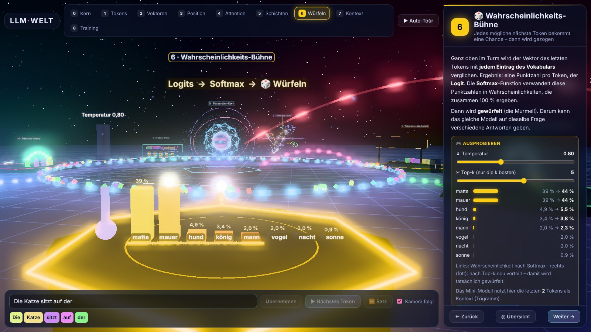 **6 · Wahrscheinlichkeits-Bühne**: Logits → Softmax → eine Murmel würfelt das nächste Wort. Regler für Temperatur und Top-k. |
| 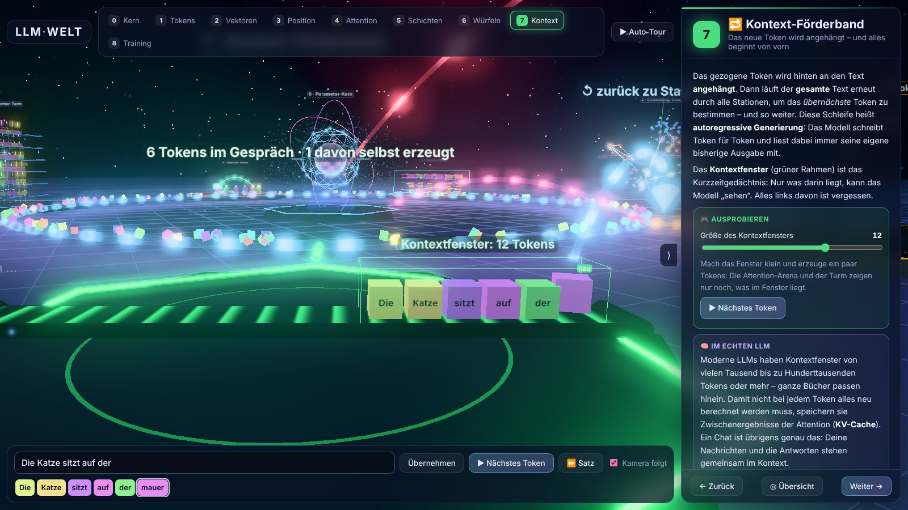 **7 · Kontext-Förderband**: Das neue Wort wird angehängt, und alles beginnt von vorn. Regler für das Kontextfenster. | 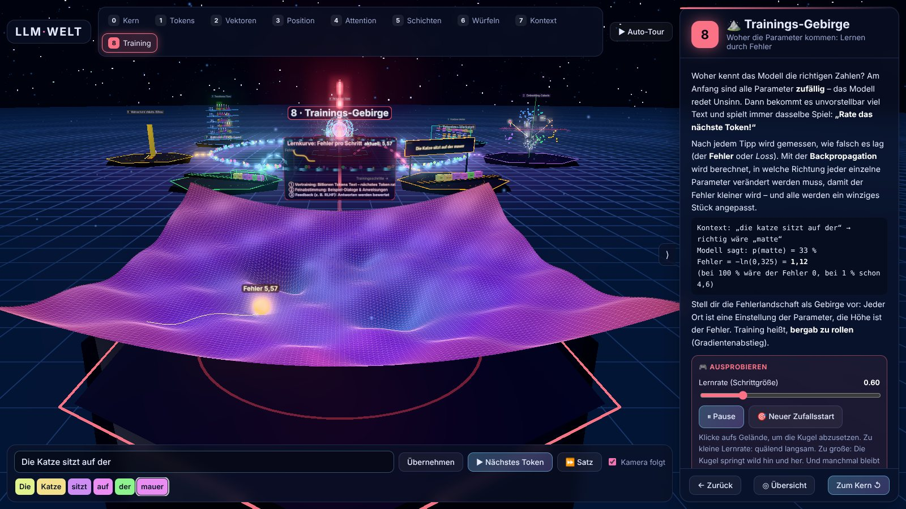 **8 · Trainings-Gebirge**: Gradientenabstieg in einer Fehlerlandschaft, mit Lernrate, Nebentälern und Lernkurve. |

Die Bilder wurden automatisch aus der laufenden Software aufgenommen.

## Bedienung

- **▶ Nächstes Token** (oder Leertaste): ein Wort erzeugen und dem Kometen durch alle Stationen folgen
- **⏩ Satz**: weiterschreiben bis zum Satzende
- **Maus**: Ziehen = drehen, Rechtsklick = verschieben, Scrollen = zoomen; Objekte sind anklickbar
- **Tasten** `0`–`8` = Stationen, `←`/`→` = vor/zurück, `O` = Übersicht
- **▶ Auto-Tour**: besucht alle Stationen nacheinander

Jede Station hat ein Erklär-Panel mit „Ausprobieren“-Elementen, einem Kasten „Im echten LLM“ mit
echten Größenordnungen und einem Kasten „Vereinfachung“.

## Lokal starten

ES-Module laden nicht über `file://`, darum einen kleinen Webserver verwenden:

```bash
git clone https://github.com/msnwasLIT/llm-welt.git
```

```bash
cd llm-welt && python3 -m http.server 8000
```

Dann <http://localhost:8000> öffnen. three.js wird von `cdn.jsdelivr.net` geladen, eine
Internetverbindung ist also nötig.

## Aufbau

```
index.html          UI-Gerüst, Import-Map für three.js
css/style.css       HUD, Panel, Prompt-Leiste
js/model.js         Mini-Modell: Tokenizer, Trigramm-LM, Embeddings, Attention (ohne three.js, in Node testbar)
js/util.js          Text-Sprites, Leucht-Shader, Plattformen, Animations-Helfer
js/main.js          Szene, Weltlayout, Datenstrom, Komet, Kamera, UI, Generierungs-Ablauf
js/zones/*.js       eine Datei pro Station (gleiche Schnittstelle: group, cam, update, pulse, panel, bind, refresh)
```

Eine neue Station ist ein weiteres Modul mit derselben Schnittstelle, das in `main.js` in den Ring
(`ring`) oder die Navigationsliste (`order`) eingetragen wird.

## Was echt ist – und was vereinfacht

- **Echt gerechnet:** Tokenisierung mit gemeinsamem Vokabular (197 Einträge), Wahrscheinlichkeiten
  aus einem Trigramm-Modell mit Backoff (gelernt aus 44 Beispielsätzen), Softmax mit Temperatur,
  Top-k-Sampling, kausale Softmax-Attention, Sinus-Positionskodierung, Gradientenabstieg.
- **Vereinfacht:** Die Embeddings sind von Hand angeordnet, die drei Attention-Köpfe sind von Hand
  gebaut, und das Mini-Modell sagt nur anhand der letzten 2 Tokens voraus. Echte LLMs lernen all das
  mit Milliarden Parametern.

## Lizenz

[MIT](LICENSE): frei nutzbar, veränderbar und weitergebbar, auch kommerziell, solange der
Lizenzhinweis erhalten bleibt.
